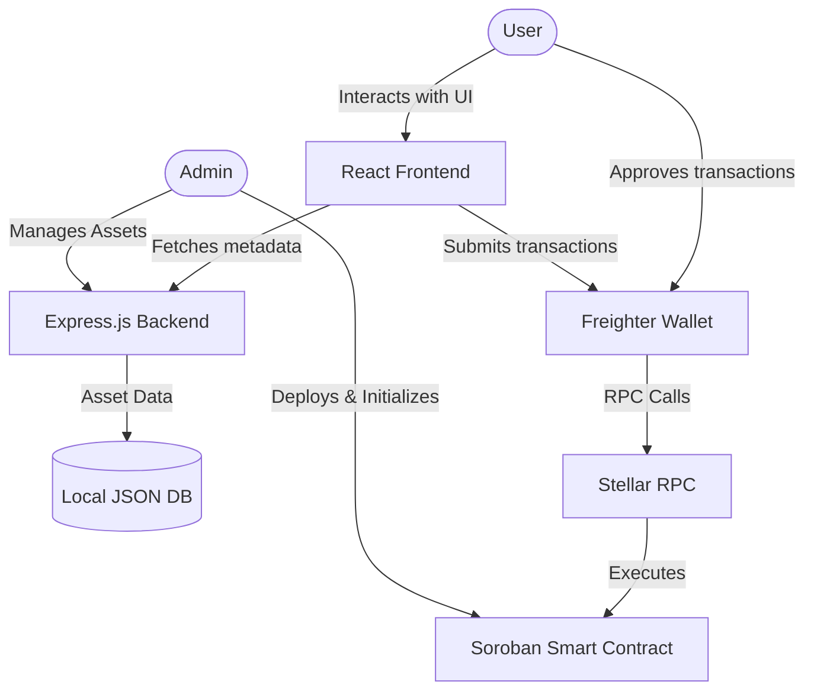
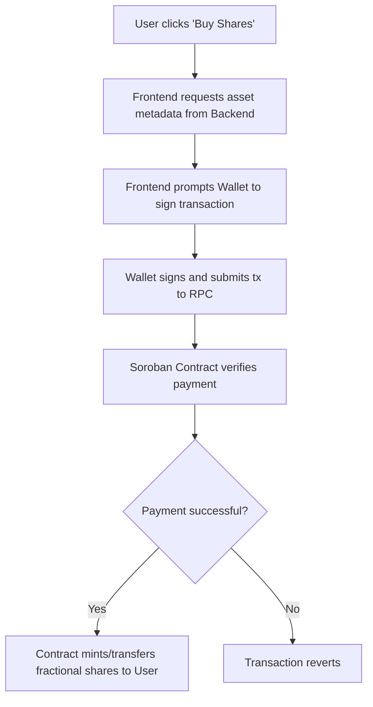
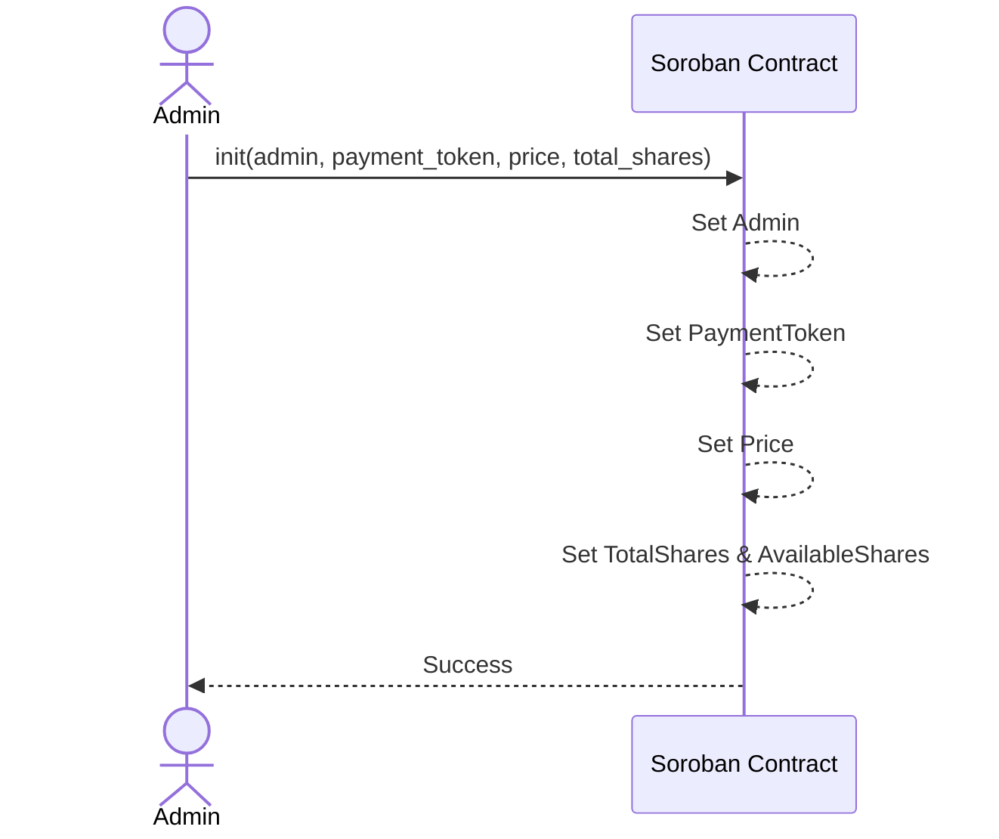
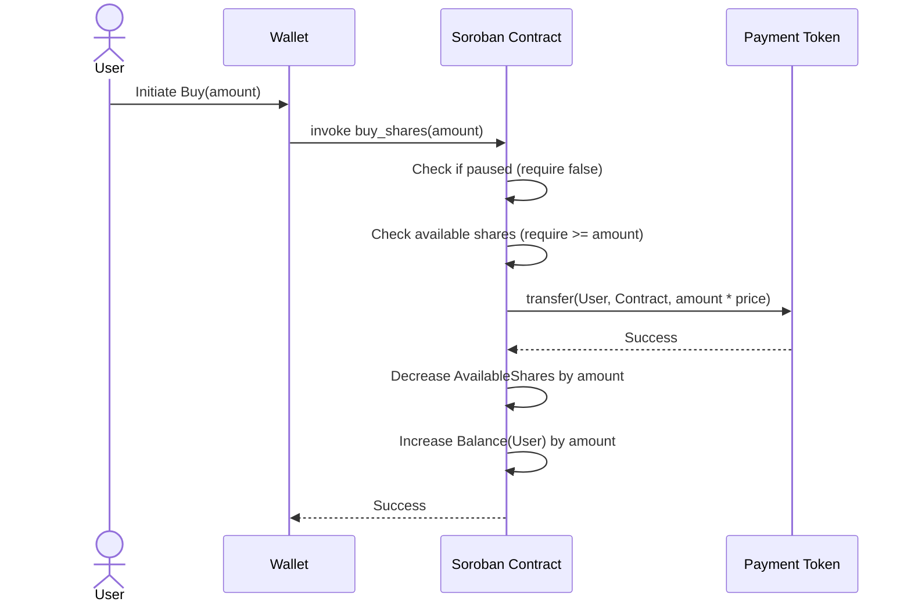

# Architecture Overview

The Tokenized Fractional Real-World Assets (RWA) Marketplace is a decentralized application built on the Stellar Network using Soroban Smart Contracts.

## System Architecture

The system consists of three main components:
1. **Frontend**: React + Vite application that interacts with the user and the Freighter wallet.
2. **Backend**: Express.js server providing off-chain metadata for the tokenized assets.
3. **Smart Contract**: Soroban contract (Rust) on the Stellar Network handling the core logic, ownership, and payments.



## Data Flow Diagrams

### Buy Shares Flow



## Smart Contract Storage Layout

The Soroban smart contract uses the following keys to store data on the ledger:

- `Admin`: The administrator's address with privileges to initialize and pause.
- `PaymentToken`: The address of the token (e.g., USDC) accepted for purchasing shares.
- `Price`: The price per fractional share.
- `TotalShares`: The maximum number of shares available for the asset.
- `AvailableShares`: The current number of shares remaining for purchase.
- `IsPaused`: A boolean indicating if the marketplace is paused.
- `Balance(Address)`: Maps a user's address to their current share balance.
- `IsClosed` (Issue #766): Permanent wind-down flag set by `wind_down()`; never reset, and it rejects every purchase path regardless of `IsPaused`.
- `LockupPeriod` (Issue #767): Global lock-up period in seconds (absent/`0` = disabled).
- `UnlockAt(Address)` (Issue #767): Ledger timestamp at which a holder's balance unlocks.
- `PauserRole` / `TreasuryRole` / `MetadataManagerRole` (Issue #768): Addresses holding the duty-separated roles; seeded to `Admin` at `init`.

## Sequence Diagrams

### Initialize Marketplace (Admin)



### Purchase Shares (User)



## API Endpoints

### Backend API (REST)

| Method | Endpoint | Auth | Description |
|---|---|---|---|
| `GET` | `/health` | No | Health check for the backend service |
| `GET` | `/api/rwa` | No | List all real-world assets available |
| `GET` | `/api/rwa/:contractId` | No | Get metadata for a specific asset |
| `POST` | `/api/rwa` | `x-api-key` | Create or update asset metadata |
| `DELETE` | `/api/rwa/:contractId` | `x-api-key` | Delete asset metadata |

### Smart Contract Functions

The **Affected by Pause** column states whether `pause()` (i.e. `IsPaused == true`)
blocks the function. Read-only `get_*` view functions are **never** blocked by a
pause, so the frontend can keep rendering balances, prices and metadata during
an incident (see [Pause semantics](#pause-semantics)).

| Function | Access | Affected by Pause | Description |
|---|---|---|---|
| `init` | Admin | n/a (pre-init) | Initializes the marketplace configuration, including the optional `lockup_period` (Issue #767). |
| `buy_shares` | Any | Yes | Purchases a specified amount of shares using an accepted payment token. |
| `buy_vested_shares` | Any | Yes | Purchases shares subject to a vesting schedule. |
| `buy_from_order` | Any | Yes | Fills an open sell order. |
| `place_sell_order` | Any | Yes | Escrows shares into a new sell order. |
| `cancel_sell_order` | Any | Yes | Cancels an open sell order and returns the escrowed shares. |
| `buyback_shares` | Any | Yes | Sells shares back to the contract at the current price. |
| `transfer_shares` | Any | Yes | Transfers shares between two whitelisted holders. |
| `transfer_shares_from` | Any | Yes | Transfers shares using an allowance. |
| `batch_transfer` | Any | Yes | Transfers shares to several recipients. |
| `get_shares` | Any | No | Returns the number of shares owned by a user. |
| `get_available_shares` | Any | No | Returns the remaining shares available for purchase. |
| `get_total_shares` | Any | No | Returns the total supply of shares for the asset. |
| `get_price` | Any | No | Returns the price per share. |
| `get_holders` | Any | No | Returns every address with a registered share position (cap table). |
| `get_admin` | Any | No | Returns the address that currently administers the contract. |
| `get_payment_token` | Any | No | Returns the default payment token. |
| `get_accepted_tokens` | Any | No | Returns the list of accepted payment tokens. |
| `get_pending_distribution` | Any | No | Returns the income a holder can currently claim. |
| `get_unclaimed_distribution` | Any | No | Returns the total deposited-but-unclaimed income. |
| `get_contract_metadata` | Any | No | Returns the SIP-4 compliant contract metadata. |
| `is_paused` | Any | No | Returns whether the marketplace is currently paused. |
| `pause` | Pauser role (defaults to admin) | n/a | Pauses the marketplace to prevent new state-changing operations. |
| `unpause` | Pauser role (defaults to admin) | n/a | Unpauses the marketplace. |
| `wind_down` | Admin | n/a | Irreversibly ends the marketplace (Issue #766): sets `IsClosed` **and** the pause flag. |
| `burn_shares` | Admin | No | Burns `amount` shares from a holder, permanently reducing issued supply (Issue #766). |
| `is_closed` | Any | No | Returns whether the marketplace has been permanently wound down. |
| `set_pauser` | Admin | No | Assigns the Pauser role (Issue #768). |
| `set_treasury` | Admin | No | Assigns the Treasury role (Issue #768). |
| `set_metadata_manager` | Admin | No | Assigns the MetadataManager role (Issue #768). |
| `get_pauser` | Any | No | Returns the address currently holding the Pauser role. |
| `get_treasury` | Any | No | Returns the address currently holding the Treasury role. |
| `get_metadata_manager` | Any | No | Returns the address currently holding the MetadataManager role. |
| `set_nft_contract` | MetadataManager role (defaults to admin) | No | Points the contract at a share-certificate NFT contract. |
| `get_lockup_period` | Any | No | Returns the configured lock-up period in seconds (0 = disabled). |
| `get_unlock_at` | Any | No | Returns the ledger timestamp at which a holder's balance unlocks (0 = unlocked). |
| `add_payment_token` | Admin | No | Adds an accepted payment token (multi-asset acceptance). |
| `remove_payment_token` | Admin | No | Removes an accepted payment token (the default cannot be removed). |
| `update_payment_token` | Admin | **Only while paused** | Migrates the default payment token; requires zero outstanding unclaimed funds in the old token. |
| `deposit_distribution` | Admin | No | Deposits asset income for pro-rata distribution to current holders. |
| `claim_distribution` | Holder | No | Claims the caller's accrued income distribution. |
| `distribute_dividends` | Admin | No | Legacy push-based pro-rata dividend distribution. |
| `claim_dividends` | Holder | No | Claims accrued dividends accrued by the policy-based flow. |
| `update_price` | Admin | Only while paused | Corrects the price per share. Requires `pause`; rejects non-positive prices. |
| `increase_total_shares` | Admin | Only while paused | Adds supply for a follow-on offering of the same underlying asset. |
| `emergency_withdraw` | Treasury role (defaults to admin) | No | Withdraws accumulated payment tokens from the contract to the admin. |

### Pause semantics

`pause()` sets `IsPaused`, which **only** blocks state-changing entry points
(see the table above) — currently `buy_shares`, `buy_vested_shares`,
`buy_from_order`, `place_sell_order`, `buyback_shares` and the transfer
entry points. It never blocks read-only view functions: `get_shares`,
`get_available_shares`, `get_total_shares`, `get_price`, `get_holders`,
`get_accepted_tokens`, `get_payment_token`, `get_contract_metadata` and the
other `get_*` functions continue to return their normal values while paused.
This is intentional: during an incident response the frontend must still be
able to display the asset's state to users.

A separate, per-function pause flag set (`pause_function` / `unpause_function`)
can block narrower groups of mutations (purchases, transfers, sell orders,
dividends, buybacks) without pausing the whole marketplace. Those flags also do
not affect read-only functions.

### Lock-up semantics (Issue #767)

`init(admin, payment_token, price, total_shares, lockup_period)` takes an optional
`lockup_period` in seconds. When set, every completed purchase extends a
per-holder unlock timestamp stored under `DataKey::UnlockAt(holder)` to
`now + lockup_period` (it is never shortened by a later purchase):

- `buy_shares`, `buy_from_order` and `batch_buy_shares` record the lock-up.
  `buy_vested_shares` does not — vesting already governs that schedule.
- While `ledger().timestamp() < unlock_at`, `transfer_shares`,
  `transfer_shares_from`, `batch_transfer`, `place_sell_order` and
  `buyback_shares` reject the holder's shares with
  `Shares are locked until ledger timestamp <t>`.
- Read-only views `get_lockup_period()` and `get_unlock_at(holder)` expose the
  configured period and a holder's current unlock time; `unlock_at == 0` means
  the balance is freely transferable.
- `init` rejects `Some(0)` with `Lockup period must be positive`; `None` means
  no lock-up is ever written.

Lock-up is independent of `IsPaused`/`IsClosed`: a purchase can be legal while a
transfer is still blocked by the lock-up window.

### End-of-life / wind-down (Issue #766)

`wind_down()` (admin only) is the permanent end-of-life switch. It sets
`IsClosed` together with `IsPaused`, and `IsClosed` is never reset:

1. **Call `wind_down()`.** Every purchase entry point — `buy_shares`,
   `buy_vested_shares`, `batch_buy_shares`, `buy_from_order` — now rejects with
   `Marketplace is closed`, even after `unpause()` clears the pause flag. The
   pause is still set so sell orders, transfers and buybacks also stop
   immediately for an orderly wind-down announcement.
2. **Re-open reads, not purchases.** View functions and
   `claim_distribution`/`claim_dividends` keep working so holders can see
   balances and exit; `unpause()` may be used to resume transfers and
   redemptions without ever re-enabling purchases.
3. **Retire remaining supply.** The admin calls `burn_shares(from, amount)` to
   permanently reduce issued supply — e.g. burning unsold inventory or
   clawing back a compliance-held position. It settles accrued distribution on
   the pre-burn balance, requires `amount > 0` and `amount <= balance`, and does
   not return shares to `AvailableShares`.
4. **Audit the result.** `is_closed()` reports the flag; `EventWindDown`
   carries the timestamp and `EventSharesBurned` carries admin, holder and
   amount for reconciliation.

Wind-down is deliberately **not** delegated to any role key: like `delist_asset`
it is irreversible, so it stays behind the admin key (see
[SECURITY.md](../SECURITY.md)).

### Asset burn / reconstitution and holder compensation (Issue #943)

`burn_and_reconstitute(asset_id, owner)` is the permanent end-of-life path for an
asset: it requires the caller to hold the asset's *entire* outstanding supply and,
once the last position is burned, archives the asset.

Because this is the wind-down / buyout mechanism, the former holder may be owed
compensation as a result of the burn — e.g. delivery of the underlying real-world
asset itself, or an off-chain payout. The contract now keeps an on-chain record of
that owed amount and publishes enough detail for the off-chain settlement process to
act on reliably:

- **On-chain compensation record** — `burn_and_reconstitute` computes the buyout
  valuation (`burned_supply * price_per_share`), records it under
  `DataKey::ReconstitutionCompensation(asset_id, owner)` before zeroing the
  holder's balance, and exposes it through the `get_reconstitution_compensation`
  view.
- **Off-chain settlement event** — the burn publishes `EventReconstituted`
  carrying `{ asset_id, owner, burned_supply, timestamp, valuation }`, i.e. the
  asset valuation plus the burn timestamp that an off-chain settlement process
  needs to reconcile payouts.

### Contract versioning policy (Issue #769)

The contract version is SemVer and is reported in two forms by
`get_contract_metadata()`:

| Field | Type | Meaning |
|---|---|---|
| `version` | `String` | Human-readable display version, e.g. `"0.4.0"`. |
| `contract_version` | `SemVer { major, minor, patch }` | Structured triple for programmatic comparison. |

All three sources are kept in lock-step and are bumped together in
`contracts/src/lib.rs`:

- `const CONTRACT_VERSION_STRING` — feeds `version`.
- `const CONTRACT_SEMVER` — feeds `contract_version`.
- `contractmeta!(key = "version", ...)` — the Wasm custom section entry read by
  explorers and indexers without executing the contract.

**Compatibility rules**

- **patch**: bug fixes and internal refactors; no ABI change. Upgrades with an
  older front-end are always allowed.
- **minor**: additive changes — new entry points or new fields in returned
  structs. Consumers must accept unknown functions/fields.
- **major**: breaking changes — removed or re-ordered entry points, changed
  argument lists, or changed stored-state layout. Every consumer
  (front-end, backend, SDK wrapper, integration) must be upgraded together.

**Minimum-supported-version check.** The front-end and backend read
`get_contract_metadata()` and compare `contract_version` against
`MIN_CONTRACT_VERSION`, refusing to submit state-changing transactions when the
on-chain contract is *older than* the minimum (it is a floor, not an exact
match, so a patch bump never breaks the dApp):

- Front-end: `frontend/src/utils/contractManifest.js` (consumed by
  `frontend/src/hooks/useContractManifest.js` and `useSoroban.js`).
- Backend: `backend/routes/health.js` reports `contractVersion` /
  `contractMinSupported` on `/readyz`.

Raise `MIN_CONTRACT_VERSION` in the same change that introduces a dependency on
a newer contract behaviour.

### Cap table enumeration

The contract keeps an on-chain holder registry (`DataKey::Holders`) that is
appended to by `register_holder` on the first purchase or first inbound
transfer of an address. `get_holders()` returns that registry, so issuers can
enumerate all addresses holding a position without relying on off-chain event
indexing. The registry is pruned of zero-balance holders during dividend
distribution, and `get_shares(addr)` remains available as an O(1) point lookup
for a single known address.

### Income / dividend distribution model

Asset income is distributed with a **pull-based accumulator** (Issue #765),
which keeps both deposit and claim cost O(1) and never iterates over holders:

- `deposit_distribution(amount)` (admin only) raises a global accumulator
  `acc += amount * 1e9 / issued_shares` and pulls the deposit from the admin
  only if the contract does not already custody the funds.
- `claim_distribution(holder)` (holder only) settles the caller's entitlement
  and transfers it.
- `get_pending_distribution(holder)` reports the claimable amount without
  mutating state.

Each holder stores an accumulator snapshot and a pending balance. The snapshot
is refreshed (settled) **before every share-balance change** — buys, transfers,
order escrow/release, vesting claims, buybacks and bridge lock/unlock — so a
holder only accrues on the balance they actually held while the accumulator
moved. This makes claims correct even when shares are transferred after a
deposit. Because the per-share entitlement is floored, a sub-unit rounding
residue can remain in the contract; it is not attributable to any holder and
can be swept with `emergency_withdraw`.

A legacy push-based distribution also exists (`distribute_dividends`,
`process_scheduled_dividend`, `claim_dividends`) using `DividendPolicy` and
`DividendPosition` for withholding, reinvestment and scheduled payouts. New
integrations should prefer `deposit_distribution` / `claim_distribution`.

## SIP‑4 / SEP‑46 Contract Metadata

The contract implements the [SIP‑4](https://github.com/stellar/stellar-protocol/blob/master/core/sip-0004.md) / [SEP‑46](https://github.com/stellar/stellar-protocol/blob/master/ecosystem/sep-0046.md) metadata standard, providing both compile-time and runtime metadata:

- **Compile-time metadata** — embedded in the Wasm `contractmetav0` custom section via the `contractmeta!()` macro. Off-chain tools (explorers, wallets, indexers) read these entries without executing the contract.
- **Runtime metadata** — stored in contract instance storage and returned by `get_contract_metadata()`. Accessible on-chain by other contracts.

### Wasm Custom Section Entries

| Key | Value |
|-----|-------|
| `name` | `RWA Marketplace` |
| `version` | `0.4.0` |
| `description` | `Tokenized Fractional RWA Marketplace` |
| `sep` | `41` |

### Data Types

```rust
#[contracttype]
pub struct SemVer {
    pub major: u32,
    pub minor: u32,
    pub patch: u32,
}

#[contracttype]
pub struct ContractMetadata {
    pub name: soroban_sdk::String,
    pub version: soroban_sdk::String,
    /// Issue #769: structured semantically-versioned contract version.
    pub contract_version: SemVer,
    pub description: soroban_sdk::String,
}
```

See [Contract versioning policy](#contract-versioning-policy-issue-769) for how
`version`, `contract_version` and the Wasm custom section stay in lock-step.
